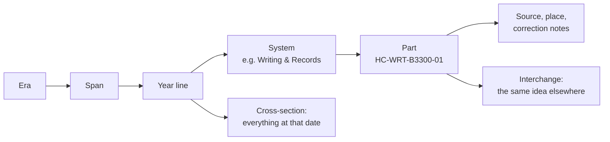

# Human Catalog: Part History

**The human story, filed like a car-parts catalog: 873 parts from our earliest ancestors about 7 million years ago to
2026, each with a permanent part number and a source we opened. Type in a year and you see everything happening on
Earth at that moment, side by side, and you watch inventions such as writing and farming turn up in several places with
no contact between them (some cases still debated).**

<p align="center">
  <a href="https://hashirama1337s.github.io/human-catalog/"></a>
</p>
<p align="center">
  
  
  
    
  
  <a href="https://doi.org/10.5281/zenodo.23977246"></a>
  
</p>

Moki & Julio (AI-assisted)

<p align="center"></p>

## The story in a minute

History books usually tell the story one country or one subject at a time. The connections get lost between the
chapters: farming began on several continents on its own, and writing was invented more than once, but you rarely see
those events on the same page.

So we built one page for all of it. Open an era, then a span, then a year line, then a part, the way you would find a
brake pad on a car-parts site. Every year line holds everything from that moment, everywhere on Earth. It runs in the
browser, with no account and no ads, and works offline.

A picture that helps: a **parts catalog**. Each event is a "part" with a permanent number, a date, a place and a source.
An open question is a "back-ordered" part, and the same invention made independently somewhere else is an
"interchange" part. Where the picture breaks: history is not made of identical spare parts. Dates are often
approximate, specialists argue about some of them, and "earliest known" only means the oldest evidence found so far.

Every part was checked against its cited source by a second reader. 296 of the 873 parts carry a correction note that
says what was wrong and gives the evidence. 864 of the 873 parts cite Wikipedia; specialist sources are being added.

## Climb the ladder

### Step 1 - the idea (for anyone)

You drill down from the big picture to one fact, then sideways to everything else happening at the same time.



Beside the parts there are 46 open questions, 96 people whose credit was missed, delayed or given to someone else (as
documented by the source), 24,117 people from Wikidata with real dates, a migration map, idea threads and two games.

### Step 2 - how it works (for a curious student)

Each part is one small text file in `data/parts/<SYSTEM>/`. A part number reads like a code: `HC-WRT-B3300-01` means
Human Catalog, Writing & Records, 3300 BCE, serial 01. Part numbers never change. Dates have no year zero, and deep time
is counted in "years ago" from 1950, as archaeologists do.

A worked example, with the real file `data/parts/WRT/HC-WRT-B3300-01.json`:

| Field | Value |
|---|---|
| title | Earliest known writing at Uruk (proto-cuneiform) |
| date, place | c. 3300 BCE, Uruk, Iraq |
| interchange | Egyptian hieroglyphs c. 3400-3200 BCE (independence debated) |
| source | https://en.wikipedia.org/wiki/Cuneiform |
| audit | corrected: "'Writing invented at Uruk' exceeds source ('first unequivocal written documents') ..." |

The part's earlier wording, "Writing invented at Uruk", went further than its source. The referee opened the source,
found that it only supports "the first unequivocal written documents", and the title became "Earliest known writing". That is the rule the catalog learned the
hard way: "earliest known", never "first ever".

Every contribution runs through automatic checks for date maths, sources, length, duplicates and "first ever"
overclaims before a person reviews it. Seven deliberately broken test parts in `tools/tests/` must all be rejected, or the check fails.

### Step 3 - the real thing (for specialists)

- **Record standard.** One JSON object per part; fields, systems, regions and rules in [SCHEMA.md](SCHEMA.md). Open
  questions carry `question`, `evidence`, `wouldSettle` and 2-4 competing `theories` that specialists actually discuss.
- **People list.** Built from Wikidata (CC0) with the queries in `tools/people/`; inclusion thresholds by era (15, 25 or
  40 Wikipedia language editions), no living people, plus everyone named in a catalog part. These rows were not refereed
  like catalog parts. Known bias: about 14 % women, leaning to Europe and North America. See
  [data/people/README.md](data/people/README.md).
- **Checks and build.** `tools/check.py` (CI on every pull request, strict on the changed files, and on every push to main) and `tools/build.py`, which writes the
  one-page site and `human-catalog.json`.
- **Corrections.** Each corrected part shows its note and evidence; post-release corrections go to
  [ERRATA.md](ERRATA.md), editions to [CHANGELOG.md](CHANGELOG.md).

## Use it as a tool

Questions this lets you answer:

- What was happening everywhere on Earth in a given year? (Cross-section in the page.)
- Which inventions turned up independently in more than one place? (Interchange; 32 parts list one.)
- Who on file was alive in a given year, and whose credit was missed?

**Just browse:** [hashirama1337s.github.io/human-catalog](https://hashirama1337s.github.io/human-catalog/). Pinned lists
share as one link, for a classroom.

**Check and rebuild it yourself** (Python 3, nothing else; run from the top folder):

```
git clone https://github.com/Hashirama1337s/human-catalog
cd human-catalog
python tools/check.py --selftest
python tools/check.py --all
python tools/build.py --out _site
```

The self-test prints seven `REJECTED` lines, one per broken test part. `check.py --all` ends with
`873 parts, 74% outside Europe, 0 errors, 43 warnings` (the warnings flag wording for a human to look at, they do not
fail). `build.py` writes `_site/index.html` (open it in a browser) and `_site/human-catalog.json`, the whole catalog in
one file.

**Reuse the data.** Who on file was alive in a given year, using the same rule as the page:

```python
import json, re

people = json.load(open('data/people/people.json', encoding='utf-8'))

def alive(r, y):
    """Same rule as the catalog page: born/died years, else born + 80, else active +-30, else died - 60."""
    by, dy = r[3], r[5]
    fl = re.search(r'fl:(-?\d+)', r[8] or '')
    if by is not None and dy is not None: return by <= y <= dy
    if by is not None: return by <= y <= by + 80
    if fl: return int(fl[1]) - 30 <= y <= int(fl[1]) + 30
    return dy - 60 <= y <= dy

rows = [r for r in people if alive(r, 1450)]
print(len(rows), 'people on file were alive in 1450')
for r in sorted(rows, key=lambda r: -r[7])[:3]:   # most widely covered first
    print(r[1], r[3], r[5])
```

It prints 781 people for 1450, led by Johannes Gutenberg, Mehmed II and Sandro Botticelli. Each row is
`[wikidata id, name, description, born, born precision, died, died precision, language editions, flags]`; negative
years are BCE. Every part file is plain JSON too: load `data/parts/*/*.json` and filter on `system`, `region`, `year`
or `interchange`.

## What we did not show

- 864 of the 873 parts cite Wikipedia. A second reader checked each part against its cited source; that is not the same as a
  specialist reviewing the history.
- "Earliest known" is the oldest evidence found so far, not proof that nothing came before. Parts marked `debated` are
  still argued about by specialists.
- The people list comes straight from Wikidata and was not refereed like the parts. It leans to Europe and North
  America and has about 14 % women; notability thresholds scale with era so the ancient world is not crowded out.
- "Interchange" lists only documented independent parallels; some (such as Uruk and Egypt) are marked as debated.
- Mistakes are likely. Report them with a source:
  - [Report an error](../../issues/new?template=report-error.yml) - you will need a source link.
  - [Suggest a part](../../issues/new?template=suggest-part.yml) - or send a pull request; see [CONTRIBUTING.md](CONTRIBUTING.md).

## Cite it

`Human Catalog — Part History, Second Edition (2.2, 2026), part HC-WRT-B3300-01. doi:10.5281/zenodo.23977246` Every part card has a copy-citation
button, and the full catalog is downloadable as `human-catalog.json`. Every edition is archived on
[Zenodo](https://doi.org/10.5281/zenodo.23977246) (this DOI always points to the newest version; v2.1 is
[10.5281/zenodo.23977247](https://doi.org/10.5281/zenodo.23977247)).

Code: [MIT](LICENSE). Catalog text and data: [CC BY 4.0](LICENSE-DATA.md). Map and fonts: see [NOTICE.md](NOTICE.md).

## Words you will meet

- **Part** - one dated event, idea or work, with a source; one file per part.
- **Part number** - permanent code such as `HC-WRT-B3300-01` (catalog, system, date code, serial).
- **System** - one of 13 subject groups, such as Food & Farming or Writing & Records.
- **Year line** - everything filed at one moment, everywhere on Earth.
- **Interchange** - the same invention made independently somewhere else, with no contact.
- **Back-ordered part** - an open question specialists cannot yet answer, with competing theories and what would
  settle it.
- **Established / Debated** - broad agreement among specialists, or a date or claim they still argue about.
- **BCE / CE** - before / in the Common Era; there is no year zero.
- **Wikidata** - a free, open database behind Wikipedia; the people list comes from it.
- **JSON** - a plain-text format for data; each part is one small JSON file.

## For specialists: the original README

The complete previous README (how it began, the "Try these" table, what's inside, how to read a part, contributing,
citation and licences) is kept verbatim in **[TECHNICAL.md](TECHNICAL.md)**.

Other projects: [github.com/Hashirama1337s](https://github.com/Hashirama1337s)
