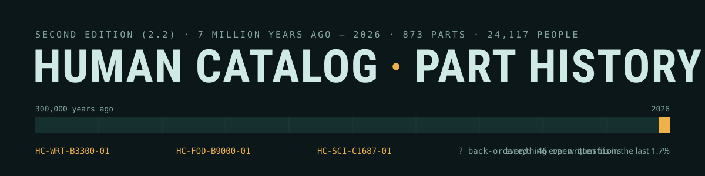
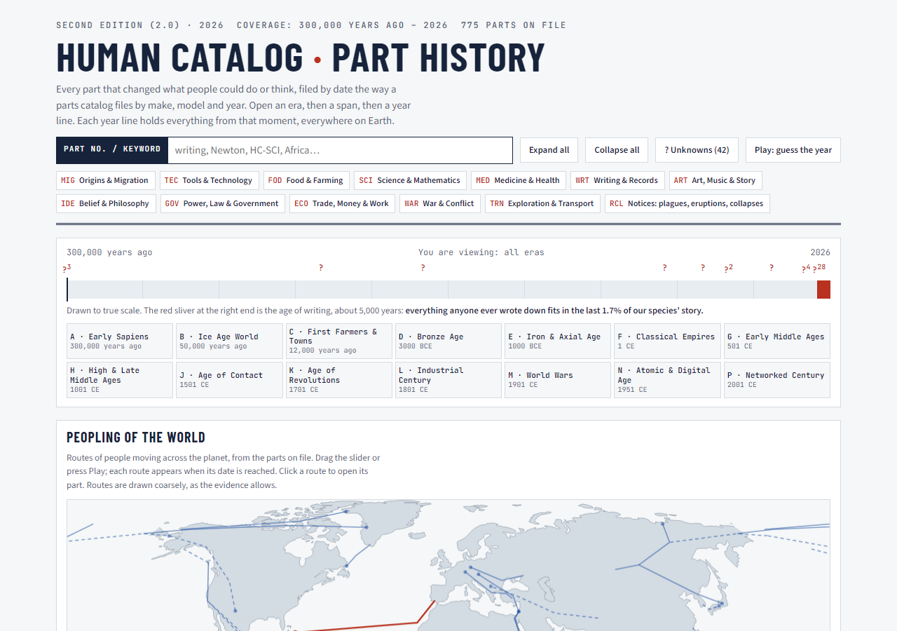
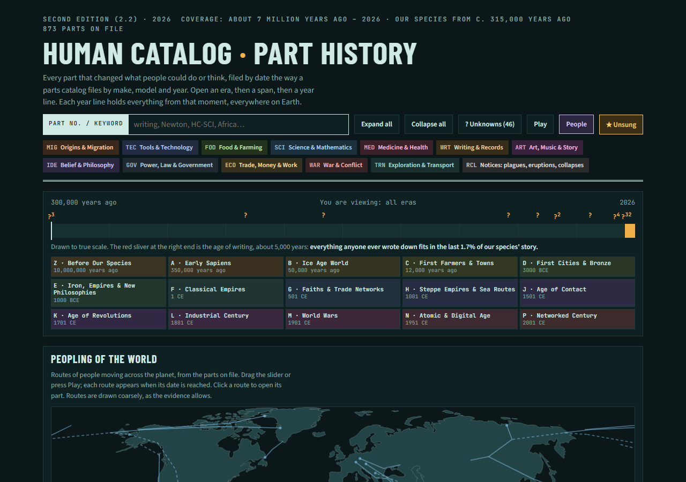

  

  
  
  
  
  
  
  

**The Human Catalog is a parts catalog for the history of our species.** Open an era, then a span, then a year line,
then a part, the way you would find a brake pad on a car-parts site. Every year line holds everything from that moment,
everywhere on Earth. One page, no account, no ads, works offline.

 

## How it began

We kept running into the same surprise. Working across many different fields, we would find an idea in one place and
then meet it again somewhere else, thousands of kilometres away, with no contact between the two. Farming began on
several continents on its own. Writing was invented more than once. Some discoveries only made sense when you set them
side by side with another one from a different century or a different part of the world.

History books usually tell these stories one country or one subject at a time, so the connections get lost between the
chapters. We wanted one place where you could see how everything fits together for humans - all of it, on a single
timeline you can zoom into with simple clicks, the way a car-parts catalog lets you drill from make to model to the
exact part.

So we built it, checked every part against a source we opened, and are giving it away. If you spot a mistake or a
missing part, tell us. It is your history too.

— Moki & Julio (AI-assisted)

## Try these

| One click | What you'll see |
|---|---|
| [Writing, invented again and again](https://hashirama1337s.github.io/human-catalog/#list.HC-WRT-B3300-01.HC-WRT-B3400-01.HC-WRT-B1250-01.HC-WRT-B250-03) | Iraq, Egypt, China and Mesoamerica, side by side |
| [Farming began on several continents](https://hashirama1337s.github.io/human-catalog/#list.HC-FOD-B9000-01.HC-FOD-B8000-02.HC-FOD-B7050-01.HC-FOD-B7050-02.HC-FOD-B8050-01.HC-FOD-B3500-01) | Barley, millet, rice, maize, potato and sorghum |
| [Newton's Principia](https://hashirama1337s.github.io/human-catalog/#HC-SCI-C1687-01) | One part, with its source, threads and citation |
| Press **? Unknowns** | 42 back-ordered parts: pick a theory, see what would settle it |
| Press **Play** | *Guess the year* (a part with its date hidden) or *Which came first?* (tap the older of two parts) |
| Type a year into **Cross-section** | Everything happening on Earth at that moment |

## What's inside

| | |
|---|---|
| **Drill-down catalog** | Era → span → year line → system → part, with permanent part numbers like `HC-WRT-B3300-01` |
| **Peopling of the World** | Press Play and watch 29 migration routes spread from Africa to the far Pacific |
| **Back-ordered parts** | Open questions as dashed "ghost" parts, with competing theories, what would settle them, and a ledger of the ones solved |
| **Idea threads** | Writing, printing, domestication, vaccines and more, linked across places and times |
| **Referee stamp** | Every part was checked against its source; corrected parts say what was wrong, with evidence |
| **Two games** | *Guess the year* and *Which came first?*, built from the catalog itself |
| **Pinned lists** | Pin parts and share one link; made for classrooms |

## How to read a part

| Field | Meaning |
|---|---|
| Part number | `HC-WRT-B3300-01` = Human Catalog, Writing & Records, 3300 BCE, serial 01. Part numbers never change. |
| Date | BCE / CE, no year zero. Deep time is "years ago", counted from 1950 as archaeologists do. "c." means circa. |
| Earliest known | The oldest evidence found so far, not proof that nothing came before. |
| Established / Debated | Broad agreement among specialists, or a date or claim they still argue about. |
| Interchange | The same part invented independently somewhere else. |
| Back-ordered | An open question: a part humanity can't supply yet. |

## Found a mistake? Know a part we missed?

- [Report an error](../../issues/new?template=report-error.yml) - you will need a source link.
- [Suggest a part](../../issues/new?template=suggest-part.yml) - or send a pull request; see [CONTRIBUTING.md](CONTRIBUTING.md).

Every contribution runs through automatic checks for date maths, sources, length, duplicates and "first ever"
overclaims before a person reviews it.

## Cite it

`Human Catalog — Part History, Second Edition (2.1, 2026), part HC-WRT-B3300-01. doi:10.5281/zenodo.23977246` Every part card has a copy-citation
button, and the full catalog is downloadable as `human-catalog.json`. Every edition is archived on
[Zenodo](https://doi.org/10.5281/zenodo.23977246) (this DOI always points to the newest version; v2.1 is
[10.5281/zenodo.23977247](https://doi.org/10.5281/zenodo.23977247)).

## Licences

Code: [MIT](LICENSE). Catalog text and data: [CC BY 4.0](LICENSE-DATA.md). Map and fonts: see [NOTICE.md](NOTICE.md).

Compiled by Moki & Julio (AI-assisted).
